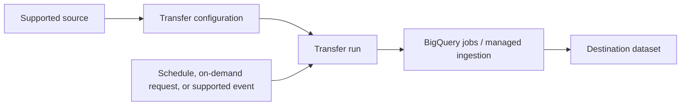



# BigQuery Data Transfer Service

> **Product Baseline — standalone product knowledge block.**
> This file contains the product knowledge needed to study this product independently.

## Learning Map

By the end of this chapter, you should be able to reason about:

- Purpose and workload fit
- Core architecture and resource model
- Key capabilities and operational model
- Security and IAM
- Networking / connectivity where relevant
- Reliability, scaling and failure modes
- Cost and performance considerations
- Migration / integration patterns
- Adjacent products and decision boundaries
- Common anti-patterns and troubleshooting signals

## Official Learning Resources

- [BigQuery Data Transfer Service overview](https://docs.cloud.google.com/bigquery/docs/dts-introduction)
- [Supported data sources](https://docs.cloud.google.com/bigquery/docs/dts-data-sources-intro)
- [BigQuery data-loading options](https://docs.cloud.google.com/bigquery/docs/loading-data)





## Product Identity

**BigQuery Data Transfer Service (DTS)** is a managed BigQuery ingestion service for automating recurring or otherwise configured data movement **into BigQuery** from supported sources. It removes the need to build and operate custom ingestion code for supported transfer types.

The key identity is:

> **Supported source → managed transfer configuration/run → BigQuery destination**

This is primarily an **ingestion and data-movement** service. It is not a general-purpose streaming processor, message broker, or arbitrary ETL engine.

### Purpose

Use BigQuery Data Transfer Service when the requirement is to make data from a supported source available in BigQuery through a managed transfer mechanism. Typical scenarios include:

- scheduled or recurring ingestion from supported SaaS, advertising, payment, database, data-warehouse, and cloud-storage sources;
- recurring Cloud Storage loads into BigQuery;
- managed transfers from supported Google services into BigQuery;
- supported warehouse migration/data-transfer paths;
- BigQuery dataset copies and scheduled queries, which are also managed through the service;
- backfills where supported to recover missing historical transfer runs.

A decisive limitation is direction: BigQuery Data Transfer Service moves supported data **into BigQuery**; it is not a service for exporting data out of BigQuery.

### Workload Shape

The default mental model is **managed recurring/batch ingestion**. Some supported transfer types also offer event-driven behavior, but this does not turn DTS into a general low-latency streaming platform.

Ask:

1. Is **BigQuery the destination**?
2. Is the **source supported** by DTS?
3. Is scheduled, recurring, on-demand, or supported event-driven ingestion compatible with the freshness requirement?
4. Is the main problem **moving/loading data**, rather than applying arbitrary processing logic?

If those conditions hold, DTS is a strong candidate.

### Need to Know

A **transfer configuration** defines how data should move from a source to a BigQuery destination. The service creates **transfer runs** according to the configured schedule or trigger. BigQuery jobs perform the underlying work appropriate to the transfer type.

The destination dataset is central to the resource model: the transfer configuration uses the same location as the destination dataset, and processing/staging occurs in that destination location.

Do not confuse these concepts:

| Term | Meaning |
| --- | --- |
| **Transfer configuration** | Persistent definition of the source, destination, parameters, credentials/identity, and schedule or trigger. |
| **Transfer run** | One execution of a transfer configuration. |
| **Destination dataset** | BigQuery dataset that receives the transferred data; its location determines the transfer configuration location. |
| **Backfill** | Running transfers for earlier periods to recover or populate historical data where the transfer supports it. |
| **Scheduled transfer** | Transfer initiated according to a recurring schedule. |
| **Event-driven transfer** | Supported transfer triggered from source events; useful for incremental ingestion, but not equivalent to immediate real-time streaming. |

### When to Choose

Choose BigQuery Data Transfer Service when **managed ingestion into BigQuery** is the actual problem and the source/transfer type is supported.

Strong signals include:

- “load this supported source into BigQuery every day/hour”;
- “avoid writing and operating custom ingestion code”;
- “backfill missing historical periods”;
- “recurring files in Cloud Storage must be loaded into BigQuery”;
- “move supported advertising/SaaS/platform data into the warehouse.”

Do not choose it merely because BigQuery appears somewhere in the architecture. The ingestion requirement, supported source, freshness target, and transformation needs must match.

### Architecture & Resource Model

The customer defines the transfer and supplies the required authorization and source-specific parameters. Google manages execution of the transfer service, but the customer remains responsible for correct source permissions, destination design, transfer configuration, monitoring, and handling failures.

### Core Capabilities

- Managed ingestion from supported sources into BigQuery.
- Scheduled recurring transfers and on-demand runs where supported.
- Backfills for supported transfer types.
- Event-driven Cloud Storage transfers for supported incremental-ingestion scenarios.
- Dataset-copy and scheduled-query operations managed through the same service family.
- Console, `bq`, and API management interfaces.

The exact schedule, parameters, authentication method, schema behavior, and limitations vary by source type; source-specific behavior is therefore part of product selection.

### Security & Networking

Two security concerns must be separated:

- **Control plane:** who can create, update, inspect, and run transfer configurations.
- **Data plane:** which identity can read the source and write or start the required jobs against the destination.

Transfer types can use user credentials or supported service-account authorization. Source-specific permissions still matter; granting BigQuery permissions alone does not automatically grant access to the source system.

The BigQuery Data Transfer Service also uses a Google-managed service agent for service operations. Treat source authorization, destination permissions, and service-agent permissions as distinct concerns when troubleshooting.

### Reliability & Scaling

A managed transfer removes ingestion infrastructure from the customer's operational burden, but it does not remove responsibility for data freshness and correctness.

Operationally, monitor:

- transfer-run status and errors;
- missing or delayed runs;
- source availability and authorization;
- schema compatibility for transfer types that depend on a stable schema;
- destination dataset and job failures;
- whether a historical backfill is required after an outage or gap.

Third-party source availability can affect transfer delivery. A successful architecture therefore treats the upstream source as part of the end-to-end reliability boundary.

### Performance & Cost

DTS is selected primarily for managed ingestion rather than for arbitrary compute performance tuning. Important design factors are:

- transfer frequency and freshness requirements;
- source-specific minimum scheduling intervals and limitations;
- BigQuery jobs generated by the transfer;
- downstream BigQuery storage and query costs;
- whether a lower-latency ingestion mechanism is required.

If the requirement is immediate or very low-latency data availability, compare the transfer mechanism with streaming ingestion rather than trying to force a recurring transfer into a real-time workload.

### Runtime / Framework Compatibility

Application-language compatibility is usually not the primary service-selection criterion because DTS is a managed transfer service. It can be configured through the Google Cloud console, the `bq` CLI, or the API/client libraries.

The stronger compatibility question is **source compatibility**: is the source and required transfer behavior supported? A familiar programming language cannot compensate for an unsupported source or unsuitable freshness model.

### Migration / Modernization

DTS can reduce migration effort when an existing supported data source or warehouse needs to feed BigQuery without first building a custom ingestion framework.

Separate two decisions:

- **Migration path:** use a supported transfer mechanism to move data into BigQuery with low operational overhead.
- **Modernization path:** redesign ingestion later if the target architecture requires continuous streaming, CDC semantics, complex transformation, or a different operational model.

Compatibility can make DTS a practical migration path; the long-term freshness and processing requirements still determine whether it is the final ingestion architecture.

### Adjacent Products / Decision Boundaries

| Requirement | Prefer | Why |
| --- | --- | --- |
| Recurring managed ingestion from a supported source into BigQuery | **BigQuery Data Transfer Service** | The service directly manages supported BigQuery ingestion transfers. |
| Near-real-time database change replication into BigQuery | **Datastream** | CDC is the defining workload rather than scheduled transfer. |
| Very low-latency streaming writes into BigQuery | **BigQuery Storage Write API / appropriate streaming path** | The requirement is real-time ingestion rather than recurring transfer. |
| Arbitrary transformations or a custom Beam processing pipeline | **Dataflow** | Processing logic is the main requirement, not simply managed data movement. |
| Asynchronous event transport between producers and consumers | **Pub/Sub** | Messaging and decoupling are the architectural problem. |
| General bulk object movement between storage systems | **Storage Transfer Service** | Object transfer is the workload rather than ingestion into BigQuery tables. |

The important question is not “can these services move data?” Several can. The decision boundary is **what kind of movement, with what semantics, into what destination, at what freshness, and with how much transformation**.

### Common Anti-Patterns

- Selecting DTS for arbitrary data export **out of BigQuery**.
- Treating a recurring transfer as a substitute for true low-latency streaming when immediate availability is required.
- Selecting DTS for an unsupported source merely to avoid writing an ingestion pipeline.
- Expecting DTS to provide arbitrary Beam-style transformation logic.
- Ignoring source-specific authentication, schema, schedule, or location requirements.
- Assuming “managed” means transfer correctness and freshness no longer need monitoring.





## Terminology for Reasoning

Use product terminology before applying the decision framework.

| Term | Meaning in this domain |
| --- | --- |
| **Ingestion** | Bringing data into BigQuery so it can be stored and queried there. |
| **Transfer configuration** | Persistent definition of a managed transfer: source, destination, parameters, identity, and scheduling/trigger information. |
| **Transfer run** | A single execution of that configuration. |
| **Recurring/batch ingestion** | Data is loaded at intervals rather than written continuously as each event occurs. |
| **Backfill** | Re-running historical periods to populate or recover missing data. |
| **CDC** | Change data capture: replication of row-level database changes; this is a different workload from ordinary recurring ingestion. |
| **Streaming ingestion** | Continuous or very low-latency writes as data is produced. |
| **Transformation** | Changing, enriching, joining, or otherwise processing data rather than merely transferring/loading it. |

### Comprehension Framework

Resolve a scenario in this order:

1. **Destination:** Must the data land in BigQuery?
2. **Source:** Does DTS support the source and required transfer type?
3. **Freshness:** Is scheduled, on-demand, or supported event-driven delivery sufficient?
4. **Semantics:** Is this managed ingestion, or does the problem actually require CDC, messaging, streaming, or complex processing?
5. **Operations:** Does the managed transfer model satisfy the desired ownership and monitoring model?
6. **Boundary:** Name the adjacent product only after identifying the requirement that DTS does not satisfy.

This turns product identity into a repeatable decision method rather than a memorized definition.





## Knowledge Check

| Question | Resolution guidance |
| --- | --- |
| What primary workload is BigQuery Data Transfer Service designed to solve? | **Resolve:** managed ingestion of data from supported sources **into BigQuery**, commonly on a scheduled/recurring basis, without building custom ingestion code. First identify BigQuery as the destination, then verify the source and required transfer behavior are supported. |
| A supported SaaS source must be loaded into BigQuery every day with minimal custom infrastructure. What should you consider first? | **Resolve:** DTS is a strong fit because the workload is recurring managed ingestion into BigQuery from a supported source. Confirm source-specific authorization, destination dataset, schedule, and schema/transfer requirements. |
| A database must replicate row-level changes into BigQuery with near-real-time CDC semantics. Is DTS automatically the best fit? | **Resolve:** no. The defining requirement is **CDC**, so compare with **Datastream**. Do not reduce the problem to “data must end up in BigQuery.” |
| Events must become queryable in BigQuery with the lowest practical latency. Should a recurring DTS schedule be forced to solve this? | **Resolve:** no. The freshness requirement changes the architectural layer. Use an appropriate streaming ingestion path; supported event-driven DTS can reduce batch delay for certain sources, but it is not a general replacement for real-time streaming. |
| A pipeline must perform complex custom transformations before writing BigQuery. What is the decision boundary? | **Resolve:** if transformation logic is the primary workload, a processing service such as **Dataflow** is a better architectural fit. DTS is strongest when managed transfer/loading is the problem. |
| Why is “managed service” not enough to complete the design? | **Resolve:** the customer must still configure source access, destination resources, transfer parameters, identity/permissions, monitoring, and failure recovery. Managed execution does not remove data-quality or freshness responsibility. |
| How would you recognize DTS without seeing the product name? | Look for the combination **supported source + BigQuery destination + managed transfer configuration + recurring/on-demand/supported event-driven ingestion + low desire for custom ingestion code**. |





## Conclusion

- BigQuery Data Transfer Service is fundamentally a **managed ingestion service into BigQuery**.
- Product selection starts with destination, source support, freshness, semantics, and operational model.
- Scheduled/recurring ingestion is different from CDC, general streaming, messaging, and arbitrary processing.
- A candidate should be able to explain both **why DTS fits** and **which requirement would move the design to an adjacent service**.


