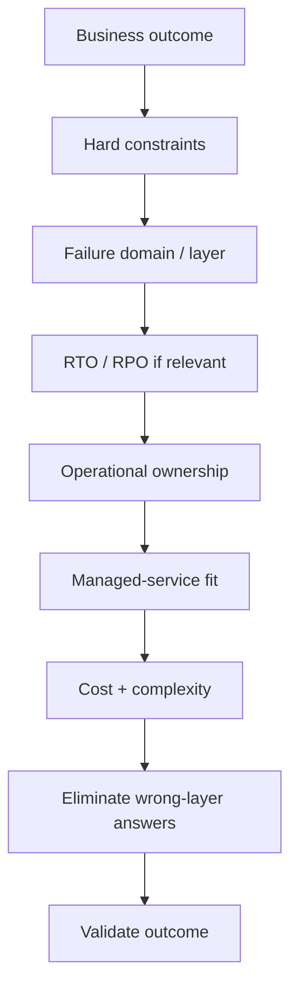
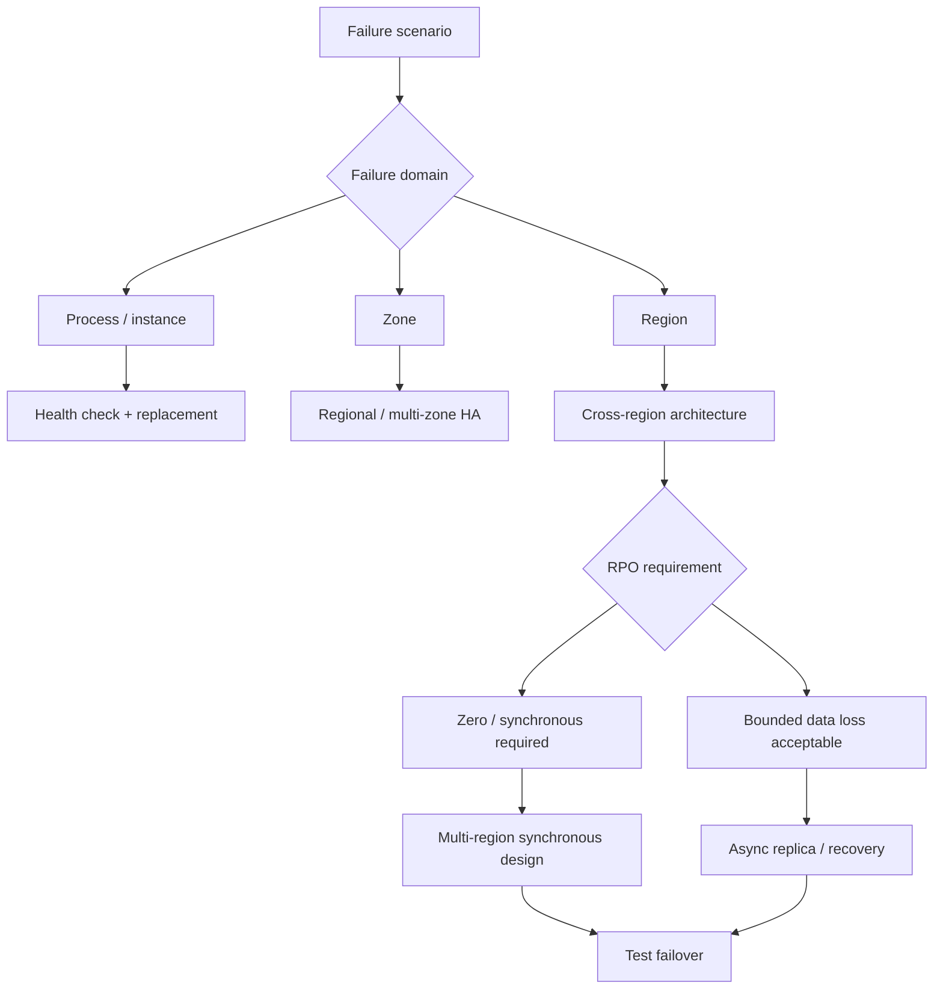
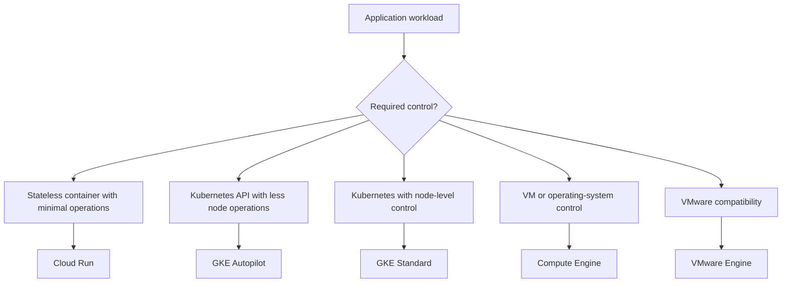
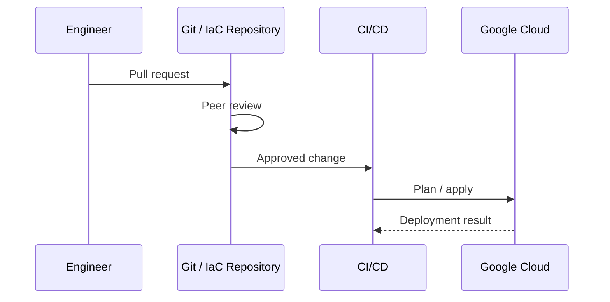



# Professional Cloud Architect — Exam Quick Reference

> **Scope:** standalone training material synthesized only from the designated Professional Cloud Architect exam corpus. All product context, comparisons, migration cues, anti-patterns, and readiness guidance required by this guide are included here.

> **Corpus boundary:** this guide does not import additional certification scope from product references, architecture guides, or other exam material. External product documentation may be used to verify technical currency, but not to expand the exam body of knowledge beyond the designated corpus.





## Exam Reasoning Loop

1. Identify the business outcome.
2. Extract technical and organizational constraints.
3. Identify the failure domain and architectural layer.
4. Translate availability requirements into RTO/RPO where relevant.
5. Determine required operational ownership/control.
6. Prefer managed, enforceable and repeatable controls when requirements allow.
7. Preserve compatibility when migration risk dominates; modernize when the business objective requires it.
8. Reject solutions that solve the wrong layer or only mask the root problem.
9. Validate that the architecture can actually achieve the promised result.





## Reliability Reasoning

**Exam rule:** HA, backup and DR are different mechanisms. A configured mechanism is not evidence that the required RTO/RPO has actually been achieved—test the recovery path.





## Product Methodology

### Cloud Run
- **Need to Know:** Managed container platform for stateless/request-driven services and related serverless workloads.
- **Choose it:** Rapid deployment, unpredictable traffic, low infrastructure ownership, scale-to-zero patterns.
- **Anti-pattern:** Choosing Kubernetes merely because the workload is containerized when no Kubernetes control is required.
- **Open Source / Migration:** Containerized applications often move naturally to Cloud Run when the container contract and stateless model fit.
- **X vs Y vs Z:** Cloud Run — serverless containers | GKE Autopilot — managed Kubernetes | GKE Standard — Kubernetes + node control | Compute Engine — VM/OS control.
- **Exam Readiness:** operational overhead, elasticity, stateless design, service identity, networking.

### GKE
- **Need to Know:** Managed Kubernetes; Standard and Autopilot operational models; regional and multi-cluster architecture.
- **Choose it:** Kubernetes API/ecosystem is required; choose Standard when node-level control is a hard requirement.
- **Anti-pattern:** Selecting GKE for a simple stateless service solely because it uses containers.
- **Open Source:** Kubernetes → GKE is the natural managed ecosystem path.
- **X vs Y vs Z:** Autopilot — reduced node operations | Standard — node-level control | Cloud Run — less infrastructure ownership | Compute Engine — VM control.
- **Exam Readiness:** regional clusters, multi-region traffic failover, node pools, DaemonSets, autoscaling, load balancing, failure domains.

### Compute Engine
- **Need to Know:** VM/OS-level compute, managed instance groups, disks, images and machine sizing.
- **Choose it:** OS/kernel/VM control or compatibility is a genuine requirement.
- **Anti-pattern:** Recreating application orchestration and autoscaling manually when a higher-level managed platform satisfies the workload.
- **Open Source / Migration:** Common rehost target; managed instance groups can reduce toil without changing the application model.
- **X vs Y vs Z:** Compute Engine — VM control | GKE — Kubernetes | Cloud Run — serverless containers | VMware Engine — VMware compatibility.
- **Exam Readiness:** MIGs, autoscaling, zones/regions, rightsizing, commitments, rehost vs modernize.

### Cloud SQL
- **Need to Know:** Managed conventional relational database; HA, backups/PITR, replicas and engine compatibility.
- **Choose it:** Existing relational engine compatibility with managed operations and requirements within its scale/availability model.
- **Anti-pattern:** Assuming single-region HA protects against a regional outage.
- **Open Source / Migration:** PostgreSQL/MySQL-style compatibility can minimize application change.
- **X vs Y vs Z:** Cloud SQL — conventional managed relational | AlloyDB — PostgreSQL-compatible higher-end managed option | Spanner — distributed/global relational scale.
- **Exam Readiness:** zonal HA vs regional DR, read replicas, backups/PITR, RTO/RPO and tested failover.

### Spanner
- **Need to Know:** Distributed relational database with strong consistency and multi-region architecture.
- **Choose it:** Relational semantics plus horizontal/global scale or stringent multi-region availability requirements justify it.
- **Anti-pattern:** Choosing Spanner merely because it is highly available when a simpler compatible database meets the requirement.
- **Open Source / Migration:** Usually a modernization decision rather than a drop-in conventional RDBMS migration.
- **X vs Y vs Z:** Spanner — distributed relational | Cloud SQL — conventional compatibility | AlloyDB — PostgreSQL-compatible managed relational | Bigtable — key-oriented NoSQL.
- **Exam Readiness:** scale, consistency, multi-region design, proportionality, application compatibility.

### Terraform / IaC
- **Need to Know:** Desired-state infrastructure, shared remote state, controlled change and repeatability.
- **Choose it:** Reproducible multi-environment infrastructure and governed change workflows.
- **Anti-pattern:** Manual console changes followed by periodic drift detection as the primary operating model.
- **Open Source:** Terraform is an IaC ecosystem; state and workflow design remain architectural responsibilities.
- **X vs Y vs Z:** IaC — desired state | CI/CD — controlled execution path | Monitoring — detection, not prevention.
- **Exam Readiness:** remote state, concurrent applies/locking, versioning/recovery, PR review, pipeline-only production changes.





## Architecture Decision Maps

### Compute

### Change Governance





## Fast Distractor Filter

- **Wrong failure domain:** zonal design for regional failure.
- **Wrong architectural layer:** database HA offered as application traffic failover.
- **Overpowered/disproportionate:** globally distributed service when simpler architecture satisfies RTO/RPO and compatibility.
- **Unnecessary self-management:** VMs/scripts where managed services meet requirements.
- **Detective instead of preventative:** monitoring drift instead of governing the change path.
- **Modernization without a business driver:** rewrite when rehost/replatform satisfies migration constraints.
- **Configuration without validation:** assuming DR targets are met because features are enabled.





In this tutorial, you learned some high level techniques can be used when learning the Professional Cloud Architect curriculum.
You also saw how patterns can be used to simplify the path to the correct answer and improve your exam performance.

## Final Readiness

- Can I identify process, instance, zone and region failure domains?
- Can I translate RTO/RPO into a suitable HA/DR architecture?
- Can I distinguish Cloud Run, GKE Autopilot, GKE Standard and Compute Engine by required control?
- Can I distinguish database HA from application availability?
- Can I design Terraform/IaC as an authoritative, reviewable deployment path?
- Can I reason about hybrid networking, IAM, organization guardrails and service perimeters at the correct layer?
- Can I choose rehost, replatform, refactor, retire or replace from the business objective rather than technical fashion?
- Can I explain why the simplest managed design is sufficient—or why a harder requirement justifies more complexity?


