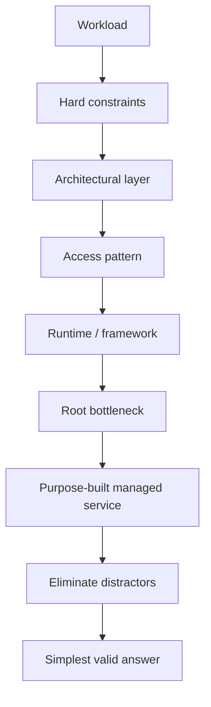
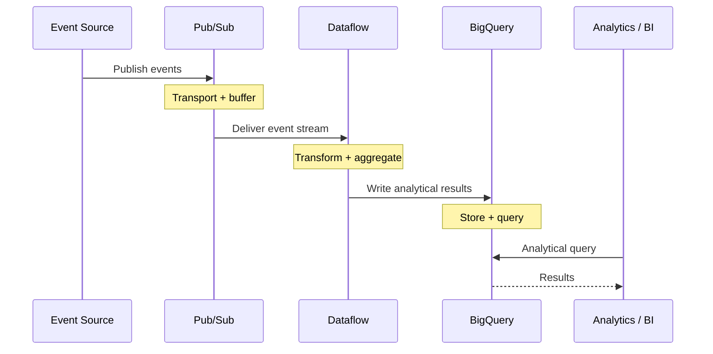
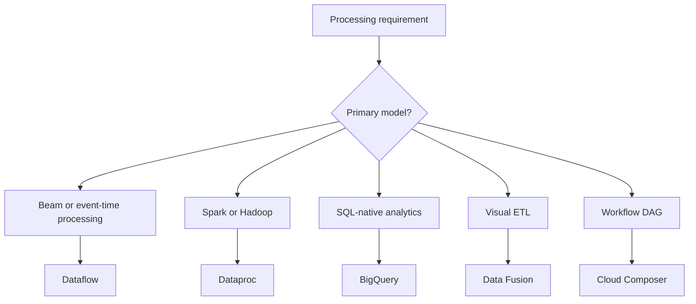
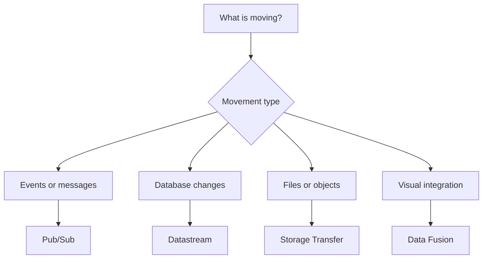



# Professional Data Engineer — Exam Quick Reference

> **Scope:** standalone training material synthesized only from the designated Professional Data Engineer exam corpus. All product context, comparisons, migration cues, anti-patterns, and readiness guidance required by this guide are included here.

> **Corpus boundary:** this guide does not import additional certification scope from product references, architecture guides, or other exam material. External product documentation may be used to verify technical currency, but not to expand the exam body of knowledge beyond the designated corpus.





## Exam Reasoning Loop

1. Classify the workload.
2. Extract hard constraints.
3. Identify the architectural layer.
4. Identify the access pattern.
5. Check runtime/framework compatibility.
6. Find the root bottleneck.
7. Prefer the purpose-built managed service where requirements allow.
8. Eliminate wrong-layer and requirement-violating distractors.
9. Choose the simplest solution satisfying the requirements.





## Canonical Data Engineering Flow

The diagram is a reasoning aid, not a mandatory architecture. Ask which layer each product owns: **transport → processing → analytical storage/query → consumption**.





## Product Methodology

Use the same six-part compression for high-value products:

### Dataflow
- **Need to Know:** Serverless batch/stream processing; Apache Beam model.
- **Choose it:** Beam, event-time processing, streaming transforms, serverless autoscaling.
- **Anti-pattern:** Existing Spark + short migration deadline → don't rewrite merely to use Dataflow.
- **Open Source:** Beam → Dataflow is natural; Spark → Dataflow is modernization.
- **X vs Y vs Z:** Dataflow — Beam/serverless | Dataproc — Spark/Hadoop | Data Fusion — visual ETL | Composer — orchestration.
- **Exam Readiness:** fusion, reshuffle, autoscaling, Pub/Sub subscriptions, safe streaming updates.

### BigQuery
- **Need to Know:** Serverless analytical warehouse; SQL; partitioning and clustering.
- **Choose it:** Large-scale analytics, warehouse-native transformations, BI/analytical querying.
- **Anti-pattern:** Treating it as a conventional OLTP database or repeatedly casting poorly modeled fields forever.
- **Open Source / Migration:** Traditional warehouse → BigQuery is a common modernization path; fix schema/type problems once when feasible.
- **X vs Y vs Z:** BigQuery — analytics | Cloud SQL — conventional relational OLTP | Spanner — globally scalable relational | Bigtable — low-latency key access.
- **Exam Readiness:** partition pruning, clustering from filters, ingestion choices, cost/query optimization, one-time schema correction.

### Pub/Sub
- **Need to Know:** Topics, subscriptions, acknowledgements, redelivery and independent consumers.
- **Choose it:** Cloud-native event ingestion, decoupled messaging and fan-out.
- **Anti-pattern:** Reusing one subscription when independent consumers/upgrades require independent delivery state.
- **Open Source / Migration:** Kafka → Pub/Sub is semantic modernization, not a drop-in migration.
- **X vs Y vs Z:** Pub/Sub — cloud-native event transport | Managed Kafka — Kafka ecosystem compatibility | Dataflow — processing, not transport.
- **Exam Readiness:** topic vs subscription, loss vs duplication, replay/retention, ordering and subscriber behavior.

### Dataproc / Managed Apache Spark
- **Need to Know:** Managed Spark/Hadoop ecosystem and compatibility-oriented processing.
- **Choose it:** Existing Spark/Hadoop jobs, ecosystem compatibility, short migration timelines.
- **Anti-pattern:** Rewriting working Spark immediately into Beam when the requirement is low-risk migration.
- **Open Source:** Spark/Hadoop → Dataproc is the natural compatibility path; Cloud Storage commonly replaces durable HDFS storage.
- **X vs Y vs Z:** Dataproc — Spark/Hadoop | Dataflow — Beam/serverless | BigQuery — SQL-native analytics.
- **Exam Readiness:** ephemeral clusters, autoscaling, Spot/preemptible workers, graceful decommissioning, Cloud Storage separation.

### Cloud Composer / Managed Airflow
- **Need to Know:** Managed Airflow; Python DAG-based workflow orchestration.
- **Choose it:** Multi-step data workflows, dependencies, schedules, retries and DAG semantics.
- **Anti-pattern:** Using Composer as the data-processing engine itself.
- **Open Source:** Airflow → Composer is the natural managed migration.
- **X vs Y vs Z:** Composer — data workflow DAGs | Workflows — service/API orchestration | Scheduler — cron trigger | Dataflow/Dataproc — execution.
- **Exam Readiness:** orchestration vs execution, event-triggered DAG patterns, private connectivity, Python DAG ≠ workload language.

### Datastream
- **Need to Know:** Managed database change data capture.
- **Choose it:** Continuous database replication/change capture into supported destinations.
- **Anti-pattern:** Using bulk file-transfer tools for live database CDC.
- **Open Source / Migration:** Preserve database semantics and connectivity requirements; CDC can coexist with bulk migration.
- **X vs Y vs Z:** Datastream — CDC | Storage Transfer — files/objects | Data Fusion — visual ETL | Pub/Sub — event messaging.
- **Exam Readiness:** private connectivity, ongoing changes vs one-time movement, source/destination roles.





## Fast Decision Maps

### Processing

### Data Movement





## Fast Distractor Filter

- **Wrong layer:** orchestration answer for a processing problem, processing answer for transport, etc.
- **Capacity instead of cause:** increase workers before fixing fusion, skew, data model or access pattern.
- **Violates hard requirements:** compatibility, deadline, connectivity, semantics or access pattern.
- **Unnecessary rewrite:** modernization when compatibility-first migration is required.
- **Wrong access pattern:** storage/database technology does not match how data is queried.
- **Reactive rather than preventative:** treats symptoms rather than the root design issue.





In this tutorial, you learned some high level techniques can be used when learning the Professional Data Engineer curriculum.
You also saw how patterns can be used to simplify the path to the correct answer and improve your exam performance.

## Final Readiness

- Can I distinguish Pub/Sub transport from Dataflow processing and Composer orchestration?
- Can I choose partitioning vs clustering from the implied query?
- Can I distinguish CDC, file transfer, event messaging and ETL?
- Can I explain Spark→Dataproc as migration and Spark→Dataflow as modernization?
- Can I diagnose Dataflow fusion/autoscaling problems before adding capacity?
- Can I select BigQuery, Bigtable, Cloud SQL or Spanner from the access pattern?
- Can I map IAM = who, Sensitive Data Protection = sensitive content, KMS/CMEK = key control, private connectivity = traffic path?


